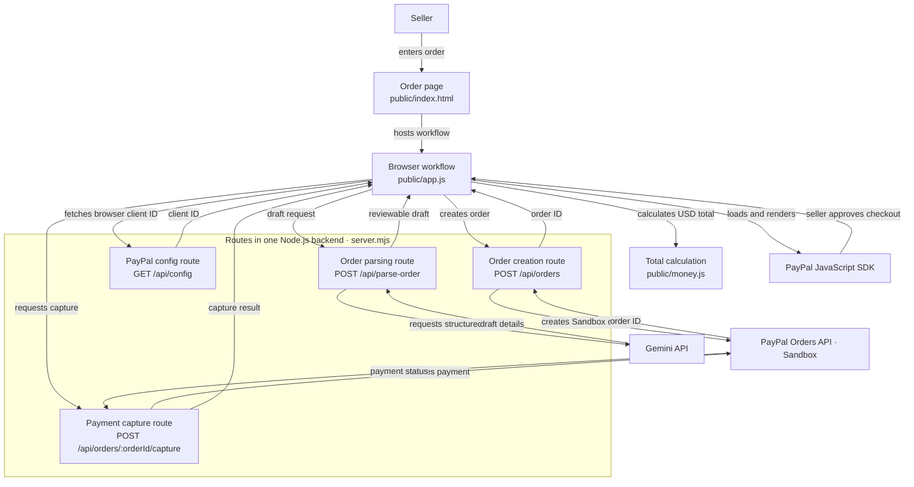

# PayFlow Copilot

An early hackathon prototype for turning a seller's plain-language order into a reviewable payment draft. Gemini parses the order, the seller edits and confirms the details, and PayPal Sandbox creates and captures the test payment. Playwright covers the first user flows.

> This is a Sandbox-only prototype. It is not a production payment system. Do not switch `PAYPAL_ENV` to `live` or use real customer information.

## Requirements

- Node.js 20 or later
- A PayPal Developer account with a Sandbox REST app
- A Gemini API key for server-side AI order parsing

## Run locally

1. Copy `.env.example` to `.env`.
2. Add your PayPal Sandbox client ID and client secret, plus your Gemini API key as `GEMINI_API_KEY2`, to `.env`.
3. Install dependencies with `npm install`.
4. Start the app with `npm start` and open `http://localhost:3000`.

Keep `.env` private. The repository ignores it. Never put the PayPal client secret or Gemini key in browser code, screenshots, or a public repository. The browser receives only the PayPal client ID required by the PayPal JavaScript SDK.

## Try the demo

Enter an order with an explicit item, quantity, and USD unit price, for example:

> 2 handmade candles at $18.50 each for Priya

Review and correct the AI draft before selecting the PayPal button. Use a Sandbox personal account as the test buyer when PayPal Checkout opens. No real funds move.

## Run the Playwright smoke tests

```sh
npm install
npx playwright install chromium
npm test
```

The smoke tests check the entry page, required input, and missing-AI-key behavior. The end-to-end payment path requires valid Sandbox credentials and is best verified manually with a Sandbox buyer account.

## Architecture



- `public/` — browser interface, displayed USD total calculation, and PayPal JavaScript SDK button.
- `server.mjs` — one Node.js backend serving the UI and handling Gemini parsing, PayPal Orders v2 creation/capture, and server-side credentials.
- `public/money.js` — decimal-to-cents conversion and rounding for the USD total; it does not convert between currencies.
- `tests/` — Playwright smoke tests.

## Hackathon status

This code is a starter implementation. Before submitting to Devpost, run it with your own Sandbox app, confirm the entire payment flow, add any features you actually complete, publish the repository with this license, and record a public demo video under three minutes.
